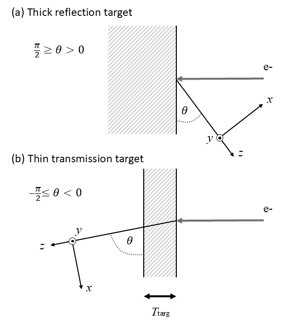

[ReadMe](../ReadMe.md),
[Further information](Further%20information.md),
[Function glossary](Function%20glossary.md),
[Release history](Release%20history.md),

# Further information

[More about SpekPy](#more-about-spekpy)

[Target geometry](#target-geometry)

[Physics models](#physics-models)

[Arguments of the Spek class](#arguments-of-the-spek-class)

[Function glossary](#function-glossary)

[Validate your installation](#validate-your-installation)

[Check what the input parameter values are for a spectrum](#check-what-the-input-parameter-values-are-for-a-spectrum)

[Specify a target material other than tungsten](#specify-a-target-material-other-than-tungsten)

[Specify a transmission target rather than reflection type tube](#specify-a-transmission-target-rather-than-reflection-type-tube)

[Get results that agree with SpekCalc](#get-results-that-agree-with-spekcalc)

[Isolate the bremsstrahlung or characteristic contribution](#isolate-the-bremsstrahlung-or-characteristic-contribution)

[If you do not want to use the default photon attenuation coefficients](#if-you-do-not-want-to-use-the-default-photon-attenuation-coefficients)

[If you want predictions off the central-axis](#if-you-want-predictions-off-the-central-axis)

[If you do not want the path-length through added filters to vary off-axis](#if-you-do-not-want-the-path-length-through-added-filters-to-vary-off-axis)

[If you want to normalize the spectrum to a reference air kerma or integrated fluence](#if-you-want-to-normalize-the-spectrum-to-a-reference-air-kerma-or-integrated-fluence)

[If you want to import an external spectrum](#if-you-want-to-import-an-external-spectrum)

[If you want to shift the energy bin centres](#if-you-want-to-shift-the-energy-bin-centres)

[If you want to use SpekPy in MATLAB](#if-you-want-to-use-spekpy-in-matlab)

## More about SpekPy

The original theoretical model underlying SpekPy was developed in two papers: [Poludniowski and Evans (2007)](https://doi.org/10.1118/1.2734725) and [Poludniowski (2007)](https://doi.org/10.1118/1.2734726). The model was adopted in a popular spectrum modelling software called [SpekCalc](https://iopscience.iop.org/article/10.1088/0031-9155/54/19/N01). [SpekPy version 1](https://doi.org/10.1016/j.ejmp.2020.04.026) implemented several theoretical and numerical improvements compared to SpekCalc, but in most cases their predictions were similar. However, the SpekPy toolkit was much more powerful than SpekCalc. Notably, it allowed the user to script calculations and to import and manipulate external spectra produced by experiment or other models. SpekPy did (and does) have a steeper learning curve though. SpekPy version 1 only allowed the modelling of W target x-ray tubes with a reflection geometry. 

In [SpekPy version 2](https://doi.org/10.1002/mp.14945), the physics models for both characterstic and bremsstrahlung emission were updated to incorporate the advances presented in Omar *et al.* (2018) and Omar *et al.* (2020) Part I and Part II. While on-axis half-value-layer predictions are generally comparable between SpekPy versions 1 and 2, version 2 provided more accurate modelling of the anode-heel effect, in terms of half-value-layer, total fluence and air kerma predictions. The target materials were also extended to Mo and Rh. Note that the physics models for SpekPy version 1 are still available as options in the updated toolkit.

In 2024, [SpekPy Web](https://spekpy.smile.ki.se) was released providing similar functionality to the original SpekCalc program, but through a web app that can be run in any web browser. The app is hosted by SMAILE at Karolinska Institutet, Sweden.

In SpekPy version 2.5, the toolkit was extended to model transmission targets. Four new target materials were added, to bring the total to seven: Cr, Cu, Mo, Rh, Ag, W and Au. The option to estimate kerma and half-value layers in terms of water kerma rather than air kerma was also added.


## Target geometry

The target geometries for (a) reflection and (b) transmission target x-ray tubes are illustrated below.

.

In the inputs to the Spek() class, the keyword parameter 'th' represents the theta variable in the diagram, but in degrees rather than radians. The keyword parameter 'thick' represents the target thickness Ttarg, in the units of microns. The default angle is 12 degrees and -90 degrees, respectively, for the reflection and transmission cases.


## Physics models

See the table below. Only the models highlighted in **bold** are recommended for use. Unless you have a good reason, we recommend you use the default physics mode of 'casim' for reflection tubes and 'kqp' for transission tubes. Some good reasons for using alternative models are:

* 'kqp': to verify the accuracy of 'casim' in circumstances where there is doubt e.g. to verify off-axis spectra where the anode-heel effect is important. The 'kqp' mode is slower than 'casim' (the only drawback)
* 'spekcalc': when you want predictions consistent with the popular SpekCalc software
* 'spekpy-v1': when you want to model tungsten anode spectra at a broader range of potentials than available in the version 2 models (>500 kV for W targets)

Physics model (version 2) | Physics model (version 1) | Description
------------------------------ | ------------------------------ | -----------
**'spekcalc'** | 'legacy'* | Emulates the popular SpekCalc software (Poludniowski *et al.*, 2009)
 | |
**'spekpy-v1'** | 'default'* | This was the default SpekPy version 1 model (Bujila *et al.*, 2020)
 | |
**'casim'** | N/A | Default SpekPy version 2 model for reflection tubes. Identical to the 'sim' model on the central-axis. For off-axis spectra, however, although variable self-filtration of the anode is accounted for, the integration over the bremsstrahlung angular distribution is not recalculated.
 | |
**'kqp'** | N/A | The recommended option when high accuracy is needed (Omar *et al.*, 2020 Parts I and II) and also the default model for transmission tubes** where effects of bremsstrahlung anisotropy can be more significant. The model uses an explicit treatment of electron angular distribution and the Kissel-Quarles-Pratt bremsstrahlung shape-function. However, this option is considerably slower when calculating multiple points in an x-ray field
 | |
'diff'| N/A | For academic interest only (Omar *et al.*, 2020 Part I). Instant diffusion model, analogous to SpekPy version 1 but with recalculated electron penetration data and no empirical normalizations
 | |
'uni' | N/A | For academic interest only (Omar *et al.*, 2020 Part I). Explicit treatment of electron angular distribution but uniform angular distribution for bremsstrahlung emission
 | |
'sim' | N/A | For academic interest only (Omar *et al.*, 2020 Part I). Explicit treatment of electron angular distribution but 'SIM' approximation for bremsstrahlung shape-function
 | |
'classical'*** | N/A | For academic interest only. Identical to 'uni' except for the NIST bremsstrahlung cross-section being replaced by Kramers' classical thin target result. Again, explicit treatment of electron angular distribution (no instant diffusion).

\* These inputs for the *physics* keyword will still work in SpekPy version 2.

\** Added in release 2.5.0

\*** Added in version 2.07

## Arguments of the Spek class

The Spek class is the main class and is used for creating a spectrum model. It has several possible arguments, all of which have default values. More information is provided in the table below.

Argument | Type | Description | Notes
-------------- | -------------- | ------------------ | -----------------------------------------
kvp | float | Tube potential [kV] | Default value depends on target (the user will want to specify anyway)
 | |
th | float | Effective anode angle [degrees] | Default value: 12 degrees for reflection tubes and -90 for transmission (the user should specify if known)
 | |
dk | float | Energy bin width [keV] | Default value: 0.5 keV
 | |
mu\_data\_source | string | Source of interaction data | Either 'pene' or 'nist' (the default is 'pene' for V2 models)
 | |
physics | string | Physics model | Default value of 'casim' for reflection tubes and 'kqp' for transmission (options: 'casim', 'kqp', 'spekpy-v1', 'spekcalc', 'diff', 'uni', 'sim' or 'classical')
 | |
x | float | Displacement from central axis in anode-cathode direction [cm] | Default value: 0 cm
 | |
y | float | Displacement from central axis in orthogonal direction [cm] | Default value: 0 cm
 | |
z | float | Focus-to-detector distance [cm] | Default value: 100 cm 
 | |
mas | float | Tube current-time product [mAs] | Default value: 1 mAs
 | |
brem | logical | Whether bremsstrahlung included in spectra | Default value: *true*
 | |
char | logical | Whether characteristic x rays included in spectra | Default value: *true*
 | |
obli | logical | Whether increased oblique paths through filtration are assumed for off axis positions | Default value: *true*
 | |
targ | string | The anode target material | Default value: 'W' (options: 'Cr', 'Cu', 'Mo', 'Rh', 'Ag', 'W', 'Au')
 | |
shift | float | Optional fraction to shift the energy bins (useful when matching to measurements) | Default value: 0.0
 | |
trans | bool | Whether the x-ray tube has a transmission target | Default value: *false*
 | |
thick | float | Thickness of the target layer in microns | Default value: *None* (but must be specified if transmission target)
 

## Function glossary

Full descriptions of all the functions of the SpekPy toolkit are provided in [Function glossary](Function%20glossary.md). This is a good place to look to figure out how to use the toolkit (another good place is the examples--see below).

## Validate your installation

If you want to validate your local installation of SpekPy, you can use the *test_SpekPy.py* script in the *tests* directory. To do so, make sure that you have the *pytest* package installed (via *pip* for example). Then navigate to the top-level directory of your SpekPy repository (i.e. in the downloaded package rather than where you installed SpekPy via *pip*). Then simply type at the command-line:

```python
pytest -vv
```

This should give you a detailed breakdown of the testing process. If any tests fail, then you have a problem. You can contact us if you need help (see the Contacts section in the [ReadMe](../ReadMe.md)).

## See some examples

The *examples* directory in the SpekPy repository shows a number of cases, exhibiting the use the toolkit:

* generate\_filtered\_spectrum\_and\_print\_summary\_of\_metrics.py
* generate\_filtered\_spectrum\_and\_export\_to\_file.py
* generate\_filtered\_spectrum\_and\_plot\_line\_profile\_of\_air\_kerma.py
* generate\_filtered\_spectrum\_and\_plot\_using\_matplotlib.py
* generate\_filtered\_spectrum\_and\_save\_state.py
* generate\_filtered\_spectrum\_normalized\_to\_reference\_kerma.py
* generate\_filtered_spectrum_using_all_keywords.py
* generate\_spectrum\_and\_filter\_to\_target\_hvl.py
* generate\_spectrum\_and\_use\_all\_get\_methods.py
* clone\_a\_spectrum.py
* create\_use\_remove\_new\_materials.py
* import\_external\_spectrum\_and\_print\_summary\_of\_metrics.py
* load\_presaved\_spectrum\_state\_and\_print\_summary\_of\_metrics.py
* save\_load\_remove\_spectrum\_states.py
* plot\_a\_spectrum\_using\_matplotlib_in_different_ways.py

We have tried to name the example scripts in a way that makes it easy to find a case using the functionality you are interested in.

## Check what the input parameter values are for a spectrum

You can use the *summarize()* method to display the spectrum definition. For example:

```python
import spekpy as sp
s=sp.Spek(kvp=80).filter('Al',2.5)
s.summarize()
```
will print out:

```ascii
Inputs
------
Tube Voltage: 80.0 [kVp]; Anode Angle: 12.0 [degrees]; Energy Bin: 0.5 [keV]; Bin shift fraction: None []; Physics Mode: spekpy-v2-casim [str]; Mu Data Source: pene [str]; Target: W [str]; 
x: 0.0 [cm]; y: 0.0 [cm]; z: 100.0 [cm]; Tube Load: 1.0 [mAs]; Bremsstrahlung Emission: True [bool]; Characteristic Emission: True [bool]; Oblique: True [bool]; Ref. air Kerma: None [uGy]; Ref. fluence: None [Photons cm^-2]; 
Filtration: [('Al', 2.5)] [mm]; 
```

## Specify a target material other than tungsten

As well as tungsten, SpekPy can model molybdenum and rhodium target anodes (10 to 50 kV). The keyword *targ* is used and it can take the values of 'W' (default), 'Cr', 'Cu', 'Mo', 'Rh', 'Ag' or 'Au'. For example:

```python
import spekpy as sp
s=sp.Spek(kvp=28,th=20,targ='Mo')
```

## Specify a transmission target rather than reflection type tube

As well as thick reflection tubes, thin transmission tubes can be modelled. The following models a silver transmission target of 10 microns thickness:

```python
import spekpy as sp
s=sp.Spek(kvp=30,trans=True,thick=10,targ='Ag')
```

## Get results that agree with SpekCalc

If you want predictions equivalent to SpekCalc, but with the power of the SpekPy toolkit, then you can have that. Simply use the *physics* keyword. For example:

```python
import spekpy as sp
s=sp.Spek(kvp=80,th=14,physics='spekcalc')
```

or

```python
import spekpy as sp
s=sp.Spek(kvp=80,th=14)
s.set(physics='spekcalc')
```

will both provide a spectrum in close agreement with SpekCalc. The derived metrics e.g. HVLs will not be numerically *identical* to SpekCalc, but will be very, very close.
 
## Isolate the bremsstrahlung or characteristic contribution

There are two ways to isolate bremsstrahlung from characteristic contributions to a spectrum. Firstly, it can be done using keywords. For example:

```python
import spekpy as sp
s=sp.Spek(kvp=80,th=14)
s.set(brem=True,char=False)
spk_br = s.get_spk()
s.set(brem=False,char=True)
spk_ch = s.get_spk()
```

The first call to *get_spk()* provides the bremsstrahlung spectrum, while the second provides the characteristic spectrum.

Secondly, however, we note that, if you export a spectrum to a text file (using the *export_spectrum()* method), then the 1st column is the mid-bin energy, the 2nd column is total spectrum and the 3rd the characteristic contribution.

## If you do not want to use the default photon attenuation coefficients

By default, SpekPy uses the mass-energy absorption coefficients for air from NIST and the XCOM mass-attenuation coefficients (including the coherent contribution) for physics models *spekcalc* and *spekpy-v1*. For other physics model, e.g. *casim*, SpekPy uses data derived from the PENELOPE Monte Carlo code system.

The NIST data is often used in studies but there is some debate as to whether *renormalized* cross-sections, such as are used in the PENELOPE Monte Carlo code, are more accurate (ICRU, 2016). We provide the option to choose. You can use it via the *mu_data_source* keyword:

```python
import spekpy as sp
s=sp.Spek(kvp=80,th=14,mu_data_source='nist')
```

The default value is *mu_data_source='pene'* for the default physics model (*casim*).

## If you want predictions off the central-axis

Many spectrum software applications only specify spectra on the central-axis (although you *can* use the trick of changing the anode angle to get estimates off-axis). SpekPy, however, explicitly allows estimation of off-axis spectra. There are two approaches to this. Firstly, specifying an off-axis reference point when a spectrum model is created:

```python
import spekpy as sp
s=sp.Spek(kvp=80,th=14,x=-10,y=5)
kair=s.get_kerma()
```

and

```python
import spekpy as sp
s=sp.Spek(kvp=80,th=14)
kair=s.get_kerma(x=-10,y=5)
```

Both those snippets of code will provide the air kerma at the off-axis position. In the first, the reference point is changed. In the second, it isn't. If you want to create a line-profile or image with many points, use the 2nd method, as it is faster (it doesn't involve the creation of a new model for every position). You can specify an off-axis position with all the "get" methods of SpekPy.

It is important to know that *x* is the anode-cathode direction (positive direction towards the cathode) and that *z* is the central-axis. The direction of *y* can be found using the right-hand-rule.

## If you do not want the path-length through added filters to vary off-axis

We assume that extrinsic filtration (inherent plus added) is planar and placed perpendicular to the z-axis. A consequence of this is that, as you move off-axis, the path-length through the filters increases. This contributes to the observed "heel effect". By default this increase in path-length for x-ray is included in the model. If you want to turn this off (so that all positions see the same filtration), use the *obli* (oblique) keyword:

```python
import spekpy as sp
s=sp.Spek(kvp=80,th=14,obli=False)
kair=s.get_kerma(x=-10,y=5)
```

With *obli=False* only the r-squared and change in anode self-filtration (i.e. the x-rays' escape path in the target) contribute to changes in the spectra.

## If you want to normalize the spectrum to a reference air kerma or integrated fluence

You may want to normalize a SpekPy spectra to give a certain air kerma of integrated fluence value. This can be done using the *set()* method. For example:

```python
import spekpy as sp
s=sp.Spek(kvp=80,th=14)
s.set(ref_kerma=100)
```

You can change the reference point from the default (0 cm, 0 cm, 100 cm) by e.g.

```python
s.set(x=-10, z=90)
s.set(ref_kerma=100)
```

or

```python
s.set(x=-10, z=90, ref_kerma=100)
```

Note, however, that this is *not* equivalent to:

```
#!python
s.set(ref_kerma=100)
s.set(x=-10, z=90)
```

as calling *set()* without *ref_kerma* resets to the default normalization.

If you want to normalize to a total integrated fluence, then simply use *ref_flu* instead of *ref_kerma*.

## If you want to import an external spectrum

You can import an external spectrum using the *load_from_file()* method:

```python
import spekpy as sp
s=sp.Spek.load_from_file('My spectrum.txt', ';')
```

Keywords *z* (default: 100 cm) and *mas* (default: 1 mAs) can also be specified to define a spectrum's position and exposure. Alternatively, you can normalize the air kerma or integrated fluence after importing the spectra (see above). The spectrum is assumed to be defined on-axis. All the "get" methods of SpekPy can be subsequently specified off-axis, but they will not include the effects of varying anode self-filtration.

The format of the file is this:

```ascii
# Some comment
# Another comment
# One more, if you like
10.5;0.0;0.0
11.5;10.1;0.0
12.5;97.8;0.0
13.5;1021.0;0.0
14.5;2501.7;0.0
15.5;1758.4;0.0
16.5;1201.9;0.0
17.5;706.1;0.0
18.5;307.8;0.0
19.5;13.4;0.0
```

The 1st column specifies the mid-point of the energy bins in keV. The 2nd column specifies the total fluence spectrum (# per cm2 per keV). The 3rd column specifies the characteristic contribution to the spectrum (# per cm2 per keV). The last column can be left off, if desired.

## If you want to shift the energy bin centres

The default bin centres in SpekPy are chosen for a good reason: the upper edge of the final bin is defined to be equal to the incident energy of the electrons striking the target. Different software or measurements often use other definitions which sometimes makes comparison with SpekPy awkward (especially for characteristic radiation). The user can specify a bin width by the *dk* keyword argument (default: 0.5 keV), and, since v2.0.4, a bin shift (fraction of a bin) by the keyword *shift*. The fraction shift can be up to +/-0.5. For example:

```python
import spekpy as sp
s=sp.Spek(kvp=80,th=14,shift=0.5)
k, spk = s.get_spectrum()
```

In this case, the final bin centre (last value in *k*) will now be 80 keV instead of 79.75 keV. Since SpekPy calculates the bremsstrahlung contribution to the bin at precisely the mid-bin value, the fluence bin value (last value in *spk*) will be 0.0. This is an example of a bin shift introducing a numerical error, as the half of the bin below 80 keV should in fact contribute to bremsstrahlung. In practice, this numerical error is typically negligible because the missing contribution is so small.

## If you want to use SpekPy in MATLAB

MATLAB can call Python packages. However, since Python is not packaged with MATLAB, you will need to make sure you have the reference implementation of Python (CPython) installed on your computer. Then, you will need to make sure your paths are set up so MATLAB can find Python. We also assume that you have successfully installed SpekPy. Use of Python libraries in MATLAB is made by typing *py*. The following MATLAB code uses SpekPy to calculate a HVL and plots the spectrum. The hardest work is converting Python data types to MATLAB types, when the output from SpekPy is returned.

```matlab
% MATLAB code using SpekPy
kvp = 120; % The x-ray tube potential in kV
th = 10.5; % The target anode angle
spekpyArgs = pyargs('kvp', kvp, 'th', th); % Define Python keyword arguments

s = py.spekpy.Spek(spekpyArgs); % Create a spectrum model with arguments
s.filter('Al',6.0); % Filter the spectrum with 6 mm of aluminium

hvl=s.get_hvl1();

spectrumArgs = pyargs('edges',true); % Define Python arguments
spectrumData = s.get_spectrum(spectrumArgs); % Get the spectrum data

kNumPy = spectrumData{1}; % Extract the energy bins
fNumPy = spectrumData{2}; % Extract the fluence values
kListPy = py.list(kNumPy); % Convert NumPy array to Python list
fListPy = py.list(fNumPy); % Convert NumPy array to Python list
kCellMAT = cell(kListPy); % Convert Python list to MATLAB cell array
fCellMAT= cell(fListPy); % Convert Python list to MATLAB cell array
k = cell2mat(kCellMAT); % Convert MATLAB cell array to double array
f = cell2mat(fCellMAT); % Convert MATLAB cell array to double array

plot(k, f) % Plot spectrum
xlabel('Energy bin  [keV]')
ylabel('Fluence per unit energy @ 1 m  [# cm^{2} keV^{-1}]')
title('X-ray spectrum')
```

## References

R Bujila, A Omar and G Poludniowski, *A validation of SpekPy: a software toolkit for modelling x-ray tube spectra*. Phys Med. 2020; 75:44-54.

A Omar, P Andreo and G Poludniowski, *A model for the energy and angular distribution of x rays emitted from an x-ray tube. Part I. Bremsstrahlung production*. Med Phys. 2020; 47(10):4763-4774

A Omar, P Andreo and G Poludniowski, *A model for the energy and angular distribution of x rays emitted from an x-ray tube. Part II. Validation of x-ray spectra from 20 to 300 kV*. Med Phys. 2020; 47(9):4005-4019

A Omar, P Andreo and G Poludniowski, *A model for the emission of K and L x rays from an x-ray tube*. NIM B 2018; 437:36-47.

G Poludniowski, *Calculation of x-ray spectra emerging from an x-ray tube. Part II. X-ray production and filtration in x-ray targets*. Med Phys 2007; 34(6):2175-86.

G Poludniowski and PM Evans, *Calculation of x-ray spectra emerging from an x-ray tube. Part I. electron penetration characteristics in x-ray targets*. Med Phys 2007; 34(6):2164-74.

G Poludniowski, et al., *SpekCalc: a program to calculate photon spectra from tungsten anode x-ray tubes*. Phys Med Biol 2009; 54(19):N433-8.

ICRU, *Key Data for Ionizing Radiation Dosimetry: Measurement Standards and
Applications*. ICRU Report 90. International Commission on Radiation Units and
460 Measurements, Bethesda, MD, 2016.
